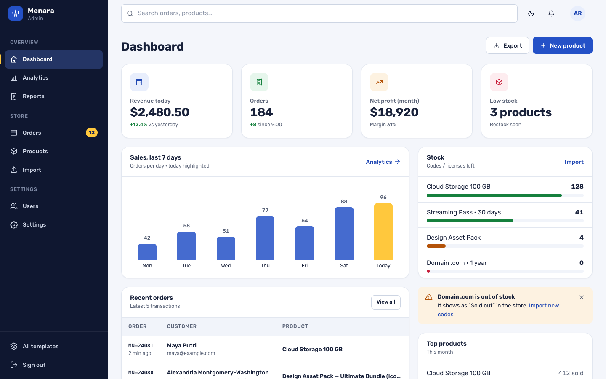

# Menara UI

**Template dashboard admin dan toko online gratis dalam HTML dan CSS biasa.** Tidak perlu build, tidak perlu framework, tanpa dependensi. Ada mode terang dan gelap, warna merek bisa diganti dari satu variabel, dan sudah termasuk *skill* AI supaya agen coding membuat halaman baru dengan gaya yang sama.

[**Demo langsung**](https://armandawahyuu.github.io/menara-ui/) · [Dokumentasi](https://armandawahyuu.github.io/menara-ui/docs/) · [Komponen](https://armandawahyuu.github.io/menara-ui/docs/components.html) · [English](README.md)



## Isinya

**Admin (10 halaman):** dashboard dengan KPI dan grafik CSS, tabel data (filter, centang semua, hapus massal), form dengan validasi, impor tempel-langsung dengan pratinjau, laporan, analitik (corong, grafik harian dan per jam), pengaturan dengan tab, pengguna, login, 404.

**Toko / landing (5 halaman):** beranda (hero, trust strip, kartu produk, ticker "baru saja dibeli", tabel perbandingan, cara pakai, FAQ, navigasi bawah di HP), produk + checkout, halaman menunggu pembayaran dengan QR dan hitung mundur, halaman sukses dengan tombol salin kode, cek pesanan.

**Fondasi:** `tokens.css` (warna, huruf, jarak, terang + gelap), `menara.css` (semua komponen), `menara.js` (ganti tema, sidebar HP, modal, tab, salin, centang semua, hitung mundur, ikon).

## Cara pakai

```bash
git clone https://github.com/armandawahyuu/menara-ui.git
```

Buka `index.html` di browser. Untuk dipakai di proyekmu, salin folder `css/` dan `js/`, lalu pasang di halaman (contoh lengkapnya ada di [README bahasa Inggris](README.md#quick-start) dan di [dokumentasi](https://armandawahyuu.github.io/menara-ui/docs/)). Mulailah dari halaman di `admin/` atau `store/` yang paling mirip dengan kebutuhanmu, lalu ganti data contohnya. Template ini bisa dipakai di Laravel Blade, Django, Rails, Express, atau HTML biasa.

## Ganti warna merek

```css
:root {
  --mn-primary: #0f766e;
  --mn-primary-hover: #0b5f59;
  --mn-primary-soft: #e6f4f2;
  --mn-primary-text: #0f766e;
}
```

Semua komponen memakai token, jadi seluruh tampilan ikut berubah. Coba langsung di [halaman demo](https://armandawahyuu.github.io/menara-ui/).

## Pakai dengan agen AI

Salin folder `skills/menara-ui/` ke `.claude/skills/` di proyekmu (atau folder skill agen yang kamu pakai). Skill ini berisi aturan layout, huruf, warna, daftar class komponen, dan larangan, supaya halaman yang dibuat AI tetap seragam.

## Bahasa

Teks template berbahasa Inggris. Untuk menerjemahkan, ganti `lang="en"` di tag `<html>` dan terjemahkan teks di HTML. Di `menara.js` hanya ada beberapa teks: label tombol tema, "Copied!", "Copied to clipboard", dan "Expired".

## Lisensi

[MIT](LICENSE) © 2026 Armanda Wahyu. Bebas dipakai, diubah, dan dijual ulang, asalkan menyertakan pemberitahuan lisensi.
