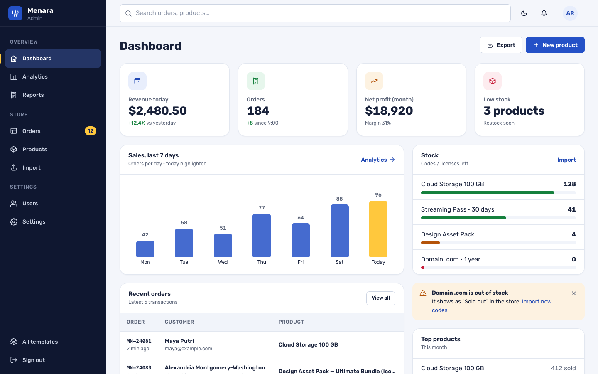
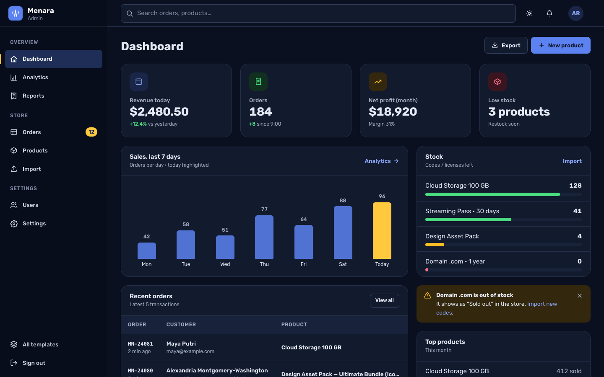
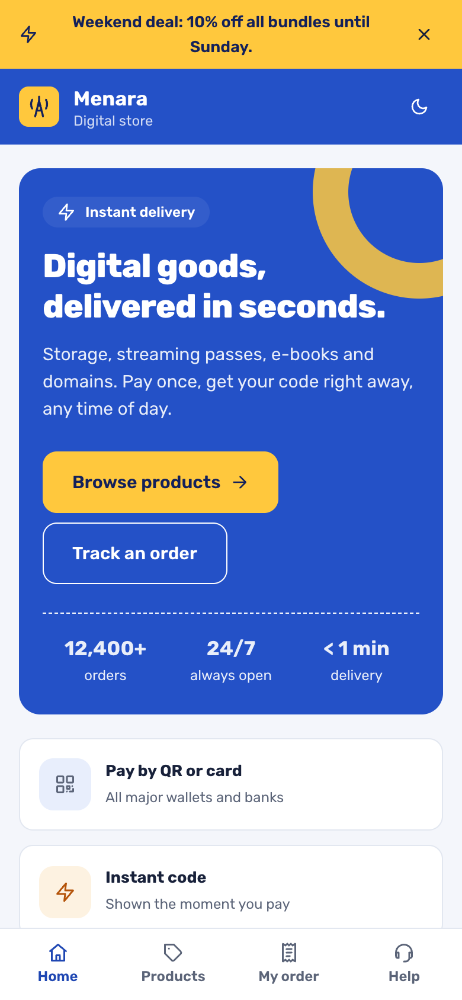
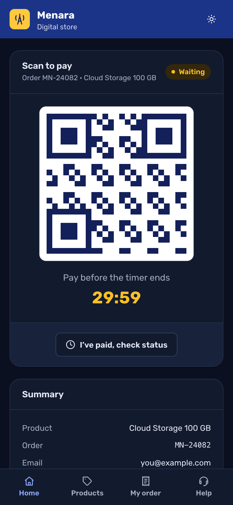

# Menara UI

**A free admin dashboard and storefront template in plain HTML and CSS.** No build step, no framework, no dependencies. Light and dark mode, rebrandable from one variable, and it ships with an AI skill so coding agents build new pages that stay on-style.

[**Live demo**](https://armandawahyuu.github.io/menara-ui/) · [Docs](https://armandawahyuu.github.io/menara-ui/docs/) · [Components](https://armandawahyuu.github.io/menara-ui/docs/components.html) · [Bahasa Indonesia](README.id.md)



| Dark mode | Storefront on a phone | Payment page |
|---|---|---|
|  |  |  |

## What's inside

**Admin (10 pages):** dashboard with KPIs and CSS charts, data table with filters, select-all and bulk delete, form with validation, paste-to-import with preview, reports, analytics (funnel, daily and hourly charts), settings with accessible tabs, users, sign in, 404.

**Storefront / landing (5 pages):** home (hero, trust strip, product grid, live "just bought" ticker, compare table, how-it-works, FAQ, mobile bottom nav), product + checkout, waiting-for-payment with QR and countdown, success with copy-to-clipboard code, order lookup.

**Foundation:** `tokens.css` (colors, type, spacing, light + dark), `menara.css` (every component), `menara.js` (theme toggle, mobile sidebar, modal, tabs, copy, select-all, countdown, icon sprite). The script is plain ES2017 with no dependencies.

## Quick start

```bash
git clone https://github.com/armandawahyuu/menara-ui.git
```

Open `index.html` in your browser. To use it in your project, copy `css/` and `js/`, then:

```html
<head>
  <script data-mn-theme-init>try{var t=localStorage.getItem('mn-theme');if(t)document.documentElement.setAttribute('data-theme',t)}catch(e){}</script>
  <link rel="stylesheet" href="https://fonts.googleapis.com/css2?family=Rubik:wght@400;500;600;700;800&display=swap">
  <link rel="stylesheet" href="css/tokens.css">
  <link rel="stylesheet" href="css/menara.css">
</head>
<body>
  …
  <script src="js/menara.js" defer></script>
</body>
```

Start from the closest page in `admin/` or `store/` and replace the dummy data. It works the same in Laravel Blade, Django, Rails, Express or plain HTML.

## Rebrand

```css
:root {
  --mn-primary: #0f766e;
  --mn-primary-hover: #0b5f59;
  --mn-primary-soft: #e6f4f2;
  --mn-primary-text: #0f766e;
}
```

Components never use raw colors, so the whole UI follows. See [Theming](https://armandawahyuu.github.io/menara-ui/docs/theming.html) for dark-mode values, or try colors live in the [demo](https://armandawahyuu.github.io/menara-ui/).

## Use it with an AI coding agent

Copy `skills/menara-ui/` into your project's `.claude/skills/` folder (or your agent's skills folder). The skill covers layout, typography, color, the component class list and a do/don't list, so generated pages match the template.

## Folder map

```
index.html            gallery of every template
css/tokens.css        design tokens (edit to rebrand)
css/menara.css        components
js/menara.js          behaviours + icon sprite
admin/                10 admin pages
store/                5 storefront pages
docs/                 documentation site + screenshots
skills/menara-ui/     AI skill (SKILL.md + references)
tools/                dev-only: page generator, checker, screenshot tests
```

## Quality

- Works from 360px wide with no horizontal scroll, up to wide desktops.
- Text contrast ≥ 4.5:1 in both themes, visible focus rings, 44px touch targets, skip links, keyboard-friendly tabs, modal and drawer, `prefers-reduced-motion` respected.
- `python3 tools/check.py` checks links, page structure and color usage. `python3 tools/shots.py` screenshots every page at 360/1280 px in light and dark and fails on overflow.

## Contributing

Pages are generated so the sidebar and headers stay identical. Edit `tools/pages/`, then run:

```bash
python3 tools/build.py && python3 tools/check.py
```

## Credits

- Font: [Rubik](https://fonts.google.com/specimen/Rubik) (SIL Open Font License).
- Icons: drawn in the style of [Lucide](https://lucide.dev) (ISC License).

## License

[MIT](LICENSE) © 2026 Armanda Wahyu
